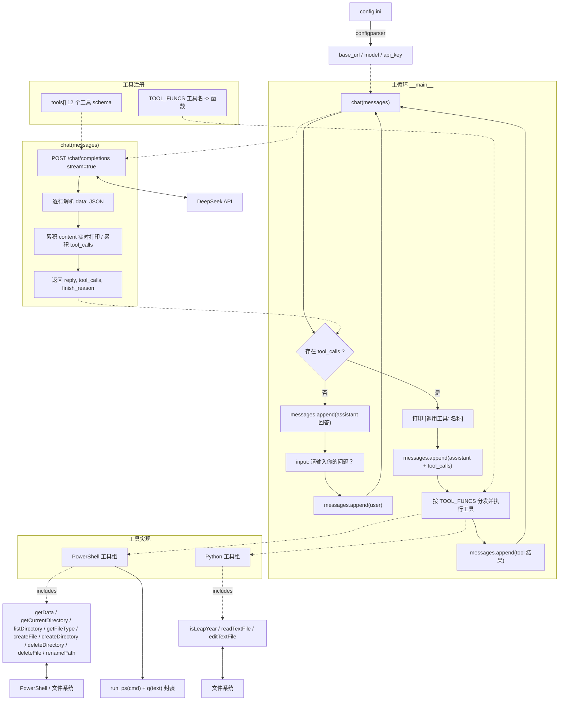

# Practice02 · Function Calling 文件操作助手

基于 DeepSeek 的流式对话程序，通过 Function Calling（工具调用）让大模型能够读取时间、判断闰年，并完成一组本地文件操作。

## 目录结构

```
Practice02/
├── chat_addtool_fileops.py              # 文件操作工具完整示例（本 README 主体）
├── chat_addtool_getdate.py              # 仅含 getData 工具的示例
├── chat_addtool_isLeapYear.py           # 含 isLeapYear 工具的示例
├── chat_addtool_fileops_architecture.mmd# 代码架构图（Mermaid）
├── config.ini                           # 接口配置
└── README.md
```

## 环境依赖

- Python 3.13（本机请使用 `py -3.13`）
- `requests`
- Windows PowerShell（文件操作工具通过它调用）

```powershell
py -3.13 -m pip install requests
```

## 配置

`config.ini`：

```ini
[default]
base_url = https://api.deepseek.com/
model = deepseek-flash
api_key = 你的 API Key
```

## 运行

```powershell
py -3.13 chat_addtool_fileops.py
```

启动后循环提示 `请输入你的问题？`，输入问题即可；模型自行决定是否调用工具，调用时会打印 `[调用工具: 名称]`。

## 工具清单

| 工具名 | 用途 | 实现方式 |
|--------|------|----------|
| `getData` | 获取当前日期时间 | PowerShell `date` |
| `isLeapYear` | 判断年份是否闰年 | Python |
| `getCurrentDirectory` | 获取当前工作目录 | PowerShell `Get-Location` |
| `listDirectory` | 列出目录下文件/子目录 | PowerShell `Get-ChildItem` |
| `getFileType` | 获取文件类型（扩展名） | PowerShell `Get-Item` |
| `readTextFile` | 读取纯文本文件内容 | Python（utf-8-sig，回退 gbk） |
| `createFile` | 创建文件（自动建目录，覆盖同名） | PowerShell `New-Item` / `Set-Content` |
| `editTextFile` | 编辑文本（overwrite / append） | Python |
| `createDirectory` | 创建目录（支持多级） | PowerShell `New-Item -ItemType Directory` |
| `deleteDirectory` | 删除目录（递归删除非空） | PowerShell `Remove-Item -Recurse` |
| `deleteFile` | 删除文件 | PowerShell `Remove-Item` |
| `renamePath` | 重命名文件/目录 | PowerShell `Rename-Item` |

## 工作流程

1. 读取用户输入，追加为 `user` 消息。
2. 调用 `chat(messages)` 流式请求模型，边收边打印，同时累积 `tool_calls`。
3. 若模型发起工具调用：
   - 打印 `[调用工具: ...]`；
   - 保存 assistant 的 `tool_calls`；
   - 按 `TOOL_FUNCS` 分发执行，结果作为 `tool` 消息追加；
   - 再次请求模型，直到得到最终回答。
4. 若无工具调用，直接保存回答，进入下一轮。
5. `messages` 全程保留完整对话历史。

## 架构图



> 源文件：[`chat_addtool_fileops_architecture.mmd`](./chat_addtool_fileops_architecture.mmd)

## 注意事项

- `config.ini` 中的 API Key 为明文，请勿提交到公开仓库。
- PowerShell 5.1 输出经重定向时按系统 ANSI（本机 GBK）编码，非 GBK 字符可能受影响；`readTextFile` / `editTextFile` 已改用 Python 以正确处理 Unicode。
- `deleteDirectory` 会递归删除非空目录，`createFile` 会覆盖同名文件，均为高危操作，请谨慎使用。
- 本机 PATH 中的 `python` 可能指向缺少依赖的虚拟环境，建议统一用 `py -3.13` 运行。
